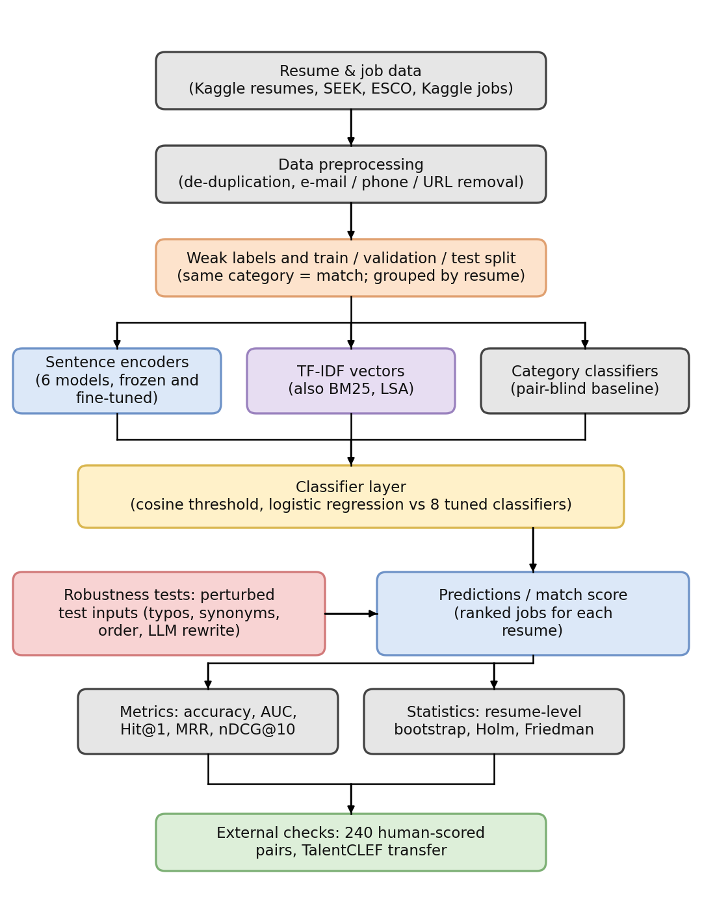

# Where does the benefit of sentence encoders come from in resume–job matching?

Code, results and figures for the paper *"Where Does the Benefit of Sentence Encoders Come From in Resume–Job Matching? A Controlled Comparison with TF-IDF"*.

We compare six sentence encoders (frozen and fine-tuned) with a tuned TF-IDF baseline on weakly labelled resume–job pairs, and ask three questions:

| RQ | Question | Folder |
|---|---|---|
| RQ1 | Representation: encoder vs TF-IDF, frozen vs fine-tuned; how much of the gain is just recognising the label's category? | `RQ1_FINAL/` |
| RQ2 | Robustness to typos, synonyms, reordering, rewrites | `RQ2_FINAL/` |
| RQ3 | Decision layer: how much does the classifier on top of a representation matter? | `RQ3_FINAL/` |



## Main findings (weak label = same category)
- Frozen general-purpose encoders gave no advantage over TF-IDF; frozen JobBERT-v2 was higher but not significant after correction.
- Fine-tuning helped a lot (accuracy 0.885–0.931 vs 0.805), but a category classifier that never sees the pair already reaches 0.829–0.895.
- The fine-tuned advantage persisted on unseen categories and against human labels.
- Frozen dense encoders were less stable than TF-IDF under typos; fine-tuning removed most of this.
- The representation mattered more than the classifier on top of it.

The labels are weak, the dataset is small (498 pairs, 166 resumes), and results are one dataset with one protocol. See the paper for all caveats.

## Repository layout
```
figures/        final figures (PDF/PNG; editable .drawio for the diagrams)
RQ1_FINAL/      data, code, results, tests for RQ1 (+ shared pipeline code)
RQ2_FINAL/      code and results for RQ2
RQ3_FINAL/      code and results for RQ3
```
Each folder has its own `README.md`, `TECHNICAL_NOTES.md` and `requirements*.txt`.

## What is *not* in this repository
- **Resume texts** and **Kaggle Glassdoor job texts.** Resumes come from the Kaggle "Updated Resume Dataset" (origin undocumented, possibly real personal data), so they are not redistributed. Download the two Kaggle files into `data/` and run `python restore_texts.py` to rebuild the texts (see `RQ1_FINAL/DATA_STATEMENT.md`).
- **TalentCLEF 2026 Task A** (CC BY 4.0) is included with its provenance file; cite the Zenodo record (DOI 10.5281/zenodo.17625261).
- **Raw rater sheets and LLM-rewritten texts.** Only anonymised aggregate human-annotation results are included (`RQ1_FINAL/results/human_annotation/`).
- **Pre-computed embedding files (`*.npz`).** They are derived from resume texts that are not redistributed, so they are not included. Regenerate them with the GPU scripts (`RQ1_FINAL/gpu_finetune_export.py`, `RQ1_FINAL/colab_export_embeddings.py`; see `RQ1_FINAL/GPU_RUNBOOK.md`; entry point `run_everything_gpu.py`).
- SEEK postings (CC BY 4.0) and ESCO files are included with attribution; see `RQ1_FINAL/NOTICE.md`.

## Reproducing
```bash
pip install -r RQ1_FINAL/requirements_gpu_pinned.txt   # pinned GPU environment
python RQ1_FINAL/check_environment.py
```
GPU steps (fine-tuning, embeddings) were run on a Kaggle/Colab T4; the entry points are `run_everything_gpu.py` and `run_v7_local.py` (see `GPU_RUNBOOK.md`). CPU analyses and the unit tests (`RQ1_FINAL/tests/`) run without a GPU.

## Citation
See `CITATION.cff`. Code is MIT-licensed; third-party data keep their own licences (`RQ1_FINAL/NOTICE.md`).
